<div align="center">

# ✦ ACOURD ✦

<a href="https://github.com/Acourd">
  
</a>

<p align="center">
  <a href="https://github.com/Acourd?tab=followers"></a>
  <a href="https://github.com/Acourd"></a>
  <a href="https://github.com/Acourd"></a>
  <a href="https://github.com/Acourd"></a>
  <a href="https://github.com/Acourd"></a>
</p>

</div>

---

### ⌗ Runtime Inspection & Profile Specification

```text
┌── acourd@sovereign-kernel:~$ whoami --spec
│
├─ Host Architecture ──── Axkern Core (Node.js 20+ Pure / Fail-Closed TCB)
├─ Confinement ────────── { executable, args, cwd, shell: false }
├─ Operational Input ──── Continuous voice dictation & cognitive agent steering
├─ Governance Layer ───── PAE RFC 8785 canonical serialization, Ed25519 DSSE
├─ State Engine ───────── Merkle CAS transactional snapshot & restore (< 3.4 ms)
├─ Verification Gate ──── Physical test suites with Exit Code 0 (Zero-Vibecoding)
│
└── acourd@sovereign-kernel:~$ cat /etc/invariants.d/discipline
    • No cosmetic stubs, no fake passes, no silent regressions.
    • Software creation at the speed of thought, governed by deterministic invariants.
```

---

### 🛡️ Engineering Philosophy

I build software through high-speed voice dictation, steering autonomous AI models without allowing them to hallucinate, introduce cosmetic placeholders, or produce silent regressions. Rather than manually writing repetitive boilerplate syntax, I design canonical domain models, enforce strict AST invariants, and demand empirical verification with **Exit Code 0**.

* **Zero-Vibecoding Gate**: Absolute eradication of synthetic mocks, empty `catch` blocks, `// TODO` stubs, and placebo patches that simulate artificial green builds.
* **Deterministic Governance**: Strict sandboxed process execution (`shell: false`), lexicographical command allowlists, PAE RFC 8785 canonical hashing, and in-toto DSSE Ed25519 cryptographic attestations.
* **Quiet Craftsmanship**: Muted obsidian and graphite surfaces, concentric micro-geometry, and responsive dark interfaces where every element fulfills a concrete operational purpose.

---

### 🚀 Flagship Architectures & Open Source

| Architecture | Focus & Identity | Stack & Invariants | Link |
| :--- | :--- | :--- | :---: |
| **[Axkern](https://github.com/Acourd/Axkern)** | **Sovereign AI Governance Microkernel**. Eliminates LLM context drift, supply-chain bloat, and fake test passes. Zero external dependencies. Fail-closed TCB, Ed25519 DSSE attestations, and Merkle CAS state rollback in `< 3.4 ms`. | `Node.js 20+` `PAE RFC 8785` `Ed25519` | [](https://github.com/Acourd/Axkern) |
| **[Graphite-Elegance](https://github.com/Acourd/Graphite-Elegance)** | **Minimalist Windows Icon Pack**. Handcrafted monochrome graphite and obsidian iconography engineered for high legibility and distraction-free desktop workflows. | `Design System` `ICO` `SVG` | [](https://github.com/Acourd/Graphite-Elegance) |
| **[Cayzen](https://github.com/Acourd/Cayzen)** | **Dark Obsidian Desktop Environment**. Custom GTK 3/4 and CSS stylesheet balancing tactile contrast with calm typography. Built for sustained focus. | `GTK 3/4` `CSS3` `Desktop` | [](https://github.com/Acourd/Cayzen) |
| **[valorant-analytics](https://github.com/Acourd/valorant-analytics)** | **Competitive Match Telemetry Engine**. 360° autodiagnostic performance radar, duo synergy audits, and adaptive aim routine generator. Pure Node.js, zero dependencies. | `Node.js` `Telemetry` `Analytics` | [](https://github.com/Acourd/valorant-analytics) |
| **[Themes](https://github.com/Acourd/Themes)** | **Curated UI Themes for Prism Launcher**. Community-tested dark themes crafted with strict typographic contrast and balanced visual hierarchy. | `CSS3` `JSON` `UI Design` | [](https://github.com/Acourd/Themes) |

---

### 📊 Live Telemetry & Rhythm

<!-- Dynamic SVG Telemetry Cards generated via github-cool-readme on the orphan 'cards' branch -->
<p align="center">
  <picture>
    <source media="(prefers-color-scheme: dark)" srcset="https://raw.githubusercontent.com/Acourd/Acourd/cards/summary-dark.svg">
    
  </picture>
  <picture>
    <source media="(prefers-color-scheme: dark)" srcset="https://raw.githubusercontent.com/Acourd/Acourd/cards/languages-dark.svg">
    
  </picture>
</p>

<p align="center">
  <picture>
    <source media="(prefers-color-scheme: dark)" srcset="https://raw.githubusercontent.com/Acourd/Acourd/cards/contributions-dark.svg">
    
  </picture>
  <picture>
    <source media="(prefers-color-scheme: dark)" srcset="https://raw.githubusercontent.com/Acourd/Acourd/cards/weekly-dark.svg">
    
  </picture>
</p>

<!-- GitHub Contribution Grid Snake Animation -->
<p align="center">
  <picture>
    <source media="(prefers-color-scheme: dark)" srcset="https://raw.githubusercontent.com/Acourd/Acourd/cards/github-snake-dark.svg">
    
  </picture>
</p>

<div align="center">
  <sub>Telemetry cards and contribution snake auto-generated on the <code>cards</code> branch via scheduled GitHub Actions. Zero external server dependencies.</sub>
</div>

---

<details>
<summary><b>🇪🇸 Manifiesto y Versión en Español</b></summary>
<br>

### ⌗ Sobre mí

Construyo software mediante dictado por voz de alta velocidad y dirección continua de modelos de inteligencia artificial, guiando agentes autónomos sin permitir que alucinen, introduzcan stubs cosméticos o rompan código en silencio. En lugar de escribir miles de líneas de sintaxis repetitiva a mano, diseño modelos de dominio sólidos, impongo contratos invariantes y exijo verificación empírica con **código de salida 0**.

- 🛡️ **[Axkern](https://github.com/Acourd/Axkern):** Microkernel de gobernanza determinista para agentes de IA con cero dependencias externas. Detiene alucinaciones, parches ciegos (*placebo patches*) y falsos verdes en tests. Atestaciones criptográficas in-toto DSSE con firmas Ed25519 y reversión Merkle CAS en `< 3.4 ms`.
- 🎨 **Diseño & Personalización de Entorno:** Diseño de interfaces oscuras y minimalistas bajo la disciplina de cromo silencioso. Creador de los iconos [Graphite-Elegance](https://github.com/Acourd/Graphite-Elegance) para Windows, el tema GTK [Cayzen](https://github.com/Acourd/Cayzen) y temas CSS para Prism Launcher.
- 🎯 **[valorant-analytics](https://github.com/Acourd/valorant-analytics):** Telemetría competitiva de Valorant, radar de autodiagnóstico en 360°, auditoría de sinergia en dúo y generador de rutinas de entrenamiento adaptativas de 15 minutos.
- ⚙️ **Filosofía Operativa:** Crear a la velocidad del pensamiento sin tolerar código frágil ni atajos cosméticos. Verificación física determinista en cada ciclo.

<br>
</details>

---

### 🛠️ Runtime Stack & Tooling

<div align="center">

| Domain | Technologies & Invariants |
| :--- | :--- |
| **Core Runtimes & Languages** | `Node.js 20+ Pure` · `JavaScript (ES2024)` · `Python 3` · `POSIX Shell` |
| **Cryptography & Governance** | `Ed25519 DSSE` · `PAE RFC 8785` · `Merkle CAS` · `in-toto Statements` · `SLSA` |
| **Desktop Systems & Theming** | `GTK 3/4` · `CSS3 (OKLCH)` · `Vector SVG` · `Windows Customization` |
| **Engineering Disciplines** | `Voice-Directed AI Steering` · `Closed-Loop TDD` · `Preflight Confinement` |

<br>


</div>

---

<div align="center">
  <sub>Sovereign Software Architecture · High-Velocity Cognitive Steering · 2026</sub>
</div>
